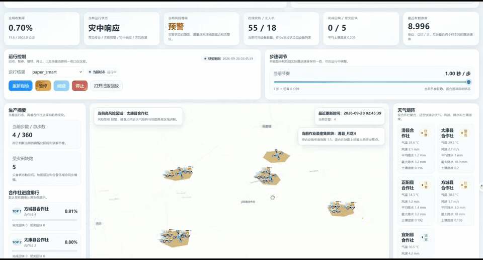
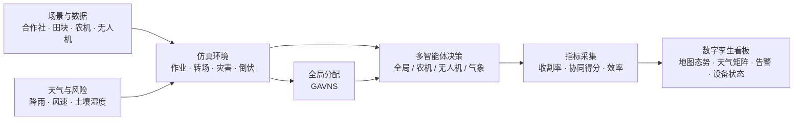
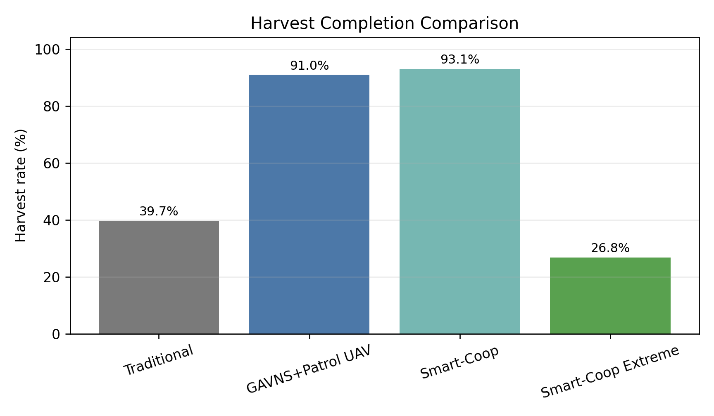
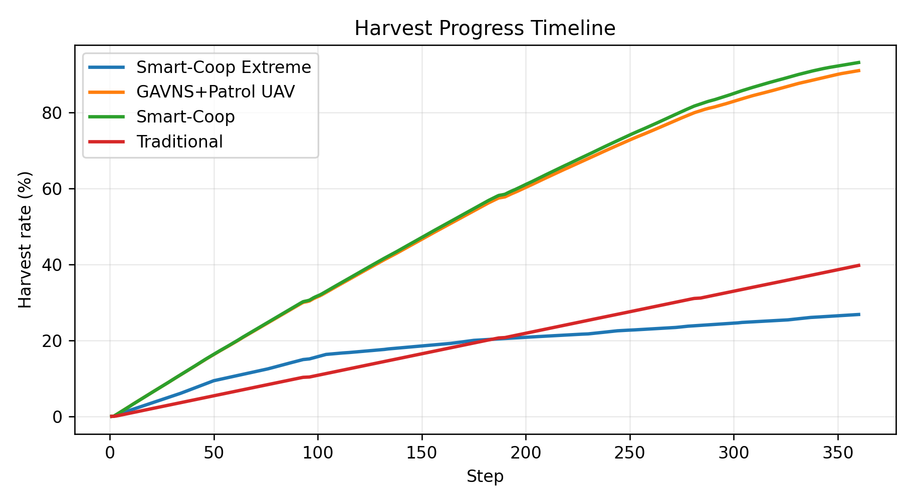
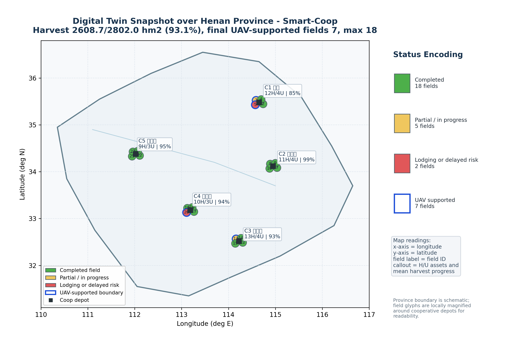

# Smart-Coop · 农机—无人机协同应急调度系统

> 用数字孪生和多智能体调度，把“三夏”抢收的完成率从传统模式的 **39.7%** 提升到 **93.1%**。

  

  ▶ <a href="docs/media/demo.mp4">观看完整演示视频（10 秒）</a>

> **这是一个项目案例页，不是开源仓库。** 核心代码私有，面试时可演示或申请只读权限。
> 界面中的地块、合作社、天气与设备均为模拟数据。

---

## 一分钟了解

| | |
|---|---|
| **问题** | “三夏”抢收窗口只有几天。连阴雨、倒伏、跨区转场，很容易出现“有机器的地方没活干、有活的地方没机器”。 |
| **做法** | 天气感知 + 无人机巡检 + GAVNS 全局分配 + 多智能体强化学习决策 + 数字孪生监控看板。 |
| **结果** | 收割完成率 **39.7% → 93.1%**，累计作业 **2,608.7 hm²**（5 合作社 / 25 田块 / 55 收割机 / 18 无人机）。 |
| **我的角色** | 数字孪生可视化看板、指标采集与实验分析、论文图表与结果整理。 |
| **背书** | 清华 IE 亮剑全国工业工程创新大赛 **国家三等奖**；中国大学生机械工程创新创意大赛·工业工程与精益管理创新赛 **全国二等奖**。 |

## 问题

河南“三夏”期间，小麦抢收的作业窗口极短。传统调度依赖经验分区和固定路线，一旦遇到持续降雨、田间倒伏、跨区转场，就会出现三类问题：

1. **信息滞后**：天气、土壤湿度、倒伏情况靠人工上报，调度决策慢半拍；
2. **资源错配**：农机扎堆或空驶，局部田块排队、局部设备闲置；
3. **协同缺失**：无人机只被当作“会飞的相机”，没有进入调度闭环。

Smart-Coop 的思路是：**把无人机变成感知节点，把收割机变成执行节点，用一个数字孪生环境把“感知—决策—执行—反馈”连起来。**

## 系统怎么做的

四个关键设计：

- **无人机进闭环**：不只是巡检，还承担作业前扫描、护航收割、异常确认、应急侦察；
- **倒伏影响效率**：倒伏等级会折减收割效率，无人机支援可以部分缓解；
- **灾害分级响应**：正常 / 预警 / 灾中 / 灾后四种状态，调度策略随之切换；
- **可解释的指标**：收割率、协同得分、数据质量、效率因子，全部可追溯。

更细的说明见 [docs/architecture.md](docs/architecture.md)。

## 结果

| 场景 | 规模 | 收割完成率 | 累计作业面积 |
|---|---|---|---|
| 传统模式（固定调度） | 55 台收割机，无无人机 | **39.7%** | — |
| **Smart-Coop（智慧协同）** | 55 台收割机 + 18 架无人机 | **93.1%** | **2,608.7 hm²** |

  

  

  

## 我负责的部分

- **数字孪生监控看板**：Flask 后端 + 前端页面，包含指标卡、地图态势、合作社排行、天气矩阵、告警事件流、设备状态面板；
- **指标采集与实验分析**：配置传统 / 巡检 / 协同 / 极端天气四组对照，整理收割率、协同得分、效率因子等指标；
- **论文与答辩材料**：结果图表、汇总表、演示脚本。

> 调度算法由团队共同完成；本页只描述我实际参与的部分。

## 技术栈

Python · Flask · Pandas / NumPy · Matplotlib · 多智能体仿真 · 强化学习（BC-PPO）· 启发式优化（GAVNS）· 数字孪生可视化

## 证据

| 类型 | 内容 |
|---|---|
| 竞赛 | 第二十届“东风日产杯”清华 IE 亮剑全国工业工程创新大赛 **国家三等奖**（2026） |
| 竞赛 | 2026 年中国大学生机械工程创新创意大赛 第九届工业工程与精益管理创新赛 **全国二等奖**（研究生组，2026.10） |
| 论文 | *Race Against Time for Wheat Harvesting: A Digital Twin-Based Emergency Cooperative Scheduling System for Agricultural Machinery and UAVs*（在投 / 修改中） |
| 时间线 | 2026.03 立项 → 2026.06 清华 IE 亮剑获奖 → 2026.10 全国二等奖 + 论文成稿 |

<!-- 把获奖证书照片放到 docs/figures/award.jpg，然后取消下面这行注释 -->
<!-- 

 -->

## 其他项目与获奖

> 以下为本人参与的其他项目，与 Smart-Coop 无关。

| 项目 | 获奖 | 时间 |
|---|---|---|
| 基于 FlexSim 的 F 公司 X 产线平衡仿真优化 | 河南省第六届工业工程创新方法应用案例大赛 **国家级二等奖**（证书待发） | 2026.10 |

## 代码与数据

- **代码**：私有仓库，不在本页公开。面试时可屏幕演示，或申请临时只读权限；
- **数据**：所有地块、合作社、天气、设备均为模拟或匿名化数据，不含真实农户、企业或个人信息；
- **论文全文**：不在本页分发，如需阅读请联系作者。

## 联系

如需代码走查或只读权限，请在本仓库开 Issue 说明来意。

## 版权

© 2026 梦之队（张光典、王培琳、王鑫冉、张文豪、宋新新）。本页文字、图表与视频未经许可不得转载或商用。
